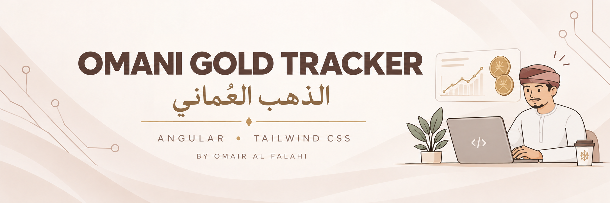
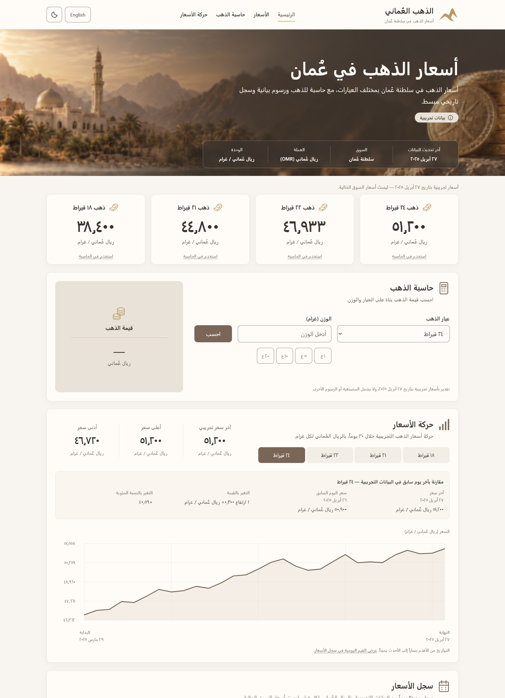
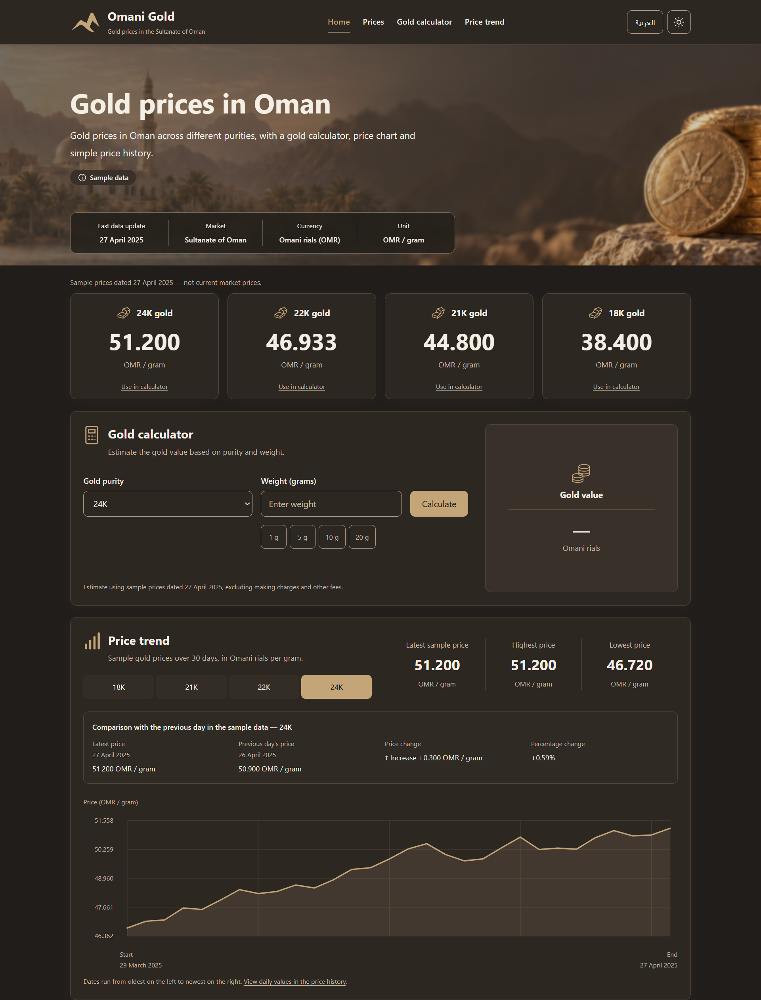

# Oman Gold Tracker — الذهب العُماني

A responsive, single-page Angular/Tailwind dashboard for exploring sample gold prices in Oman. It combines purity-based price cards, a calculator, an interactive chart, and a complete history table in a warm, bilingual interface.

[View Live Demo](https://gold-tracker-oman.netlify.app/)

## App Preview



*Arabic · Light Mode*



*English · Dark Mode*

Repository: [github.com/3ma1r/oman-gold-tracker](https://github.com/3ma1r/oman-gold-tracker)

## Features

- Reusable price cards for **18K, 21K, 22K, and 24K**, showing the final sample day's OMR-per-gram prices.
- Gold calculator with positive decimal weights, validation, calculation details, and **1g, 5g, 10g, and 20g** shortcuts.
- Interactive **30-day SVG chart** with purity selection, latest/highest/lowest statistics, and absolute/percentage comparisons with the previous sample day.
- All 30 history rows, newest first, with alternating colours and horizontal scrolling on smaller screens.
- Arabic/English switching, RTL/LTR layouts, and localized dates, numbers, currency, and accessible text.
- Light/dark themes and saved language/theme preferences using `localStorage`; switching still works when storage is unavailable.
- Responsive layouts, skeleton loading states, restrained empty/result transitions, and reduced-motion support.
- Price-card-to-calculator shortcuts, sticky section navigation with active highlighting, visible keyboard focus, and a skip-to-content link.

## Technology stack

Versions are verified against installed packages and the committed `package-lock.json`.

| Role | Technology | Version |
| --- | --- | --- |
| Application framework | Angular, standalone components and signals | 20.3.33 |
| Styling | Tailwind CSS and native CSS | 4.3.3 |
| Build tooling | Angular CLI / Angular build package | 20.3.39 |
| Language tooling | TypeScript, strict mode | 5.9.3 |
| CSS tooling | PostCSS / Tailwind PostCSS plugin | 8.5.29 / 4.3.3 |
| Testing | Karma / Jasmine | 6.4.4 / 5.9.0 |

Charts and icons use native SVG. Translation and theme services are implemented locally; no chart or translation libraries are used. The application is client-rendered, without routing, SSR, or prerendering.

## Prerequisites and local setup

Install Git, Node.js, and npm. Angular 20.3 supports **Node.js 20.19+ within 20.x, 22.12+ within 22.x, or 24.x** (`^20.19.0 || ^22.12.0 || ^24.0.0`); see the [official Angular compatibility table](https://angular.dev/reference/versions). Verification used **Node.js 22.18.0 and npm 10.9.3**. A global Angular CLI installation is not required.

```bash
git clone https://github.com/3ma1r/oman-gold-tracker.git
cd oman-gold-tracker
npm ci
npm start
```

Open **http://localhost:4200/**. The development server reloads when source files change. If port 4200 is occupied, use the URL printed by the CLI after accepting an alternative port.

`npm ci` installs from the committed lockfile. No environment file, backend, database, API, or API keys are required.

## Build and tests

Create the production build:

```bash
npm run build
```

Production is the default build configuration. Browser files and local assets are generated in **`dist/oman-gold-tracker/browser/`**. Serve them over HTTP rather than opening `index.html` directly. The current base URL and hero-image path assume hosting at the site root; subdirectory hosting requires a separate configuration change.

Run the existing Karma/Jasmine suite once in headless Chrome:

```bash
npm test -- --watch=false --browsers=ChromeHeadless
```

Google Chrome must be installed and discoverable by the Karma Chrome launcher. For a nonstandard installation, set `CHROME_BIN` to its executable path in your shell. Use `npm test` for interactive watch-mode tests.

## Project structure

```text
public/
  favicon.svg                 SVG brand mark
  images/oman-gold-hero.png    Local panoramic hero artwork
src/
  app/
    components/               Header, hero, prices/cards, calculator, trend, history, footer
    data/                     Shared sample prices and typed Arabic/English dictionary
    models/                   Purity and date-only price types
    services/                 Prices/loading, formatting, language, and theme
    app.*                     Page composition, configuration, and application tests
  index.html                  Document shell and pre-paint theme initialization
  main.ts                     Angular bootstrap
  styles.css                  Tailwind imports, theme tokens, layout, and motion
angular.json                  Build, server, assets, and Karma configuration
package.json                  npm scripts and dependencies
package-lock.json             Locked dependency versions
```

Component and service tests are colocated as `*.spec.ts`.

## Sample data and calculations

There are exactly **30 consecutive calendar dates: 29 March–27 April 2025**. Prices are static illustrations, **not live prices or verified historical market rates**. The hero's last-data-update date refers to this fixed dataset, not today's date.

Only the 24K series is stored. Other purities are derived directly using `24K price × karat / 24`, consistently rounded half-up to three decimals using integer baisa arithmetic. One shared service supplies cards, calculator, chart/tooltips, and history. Dates are stored as `YYYY-MM-DD` and displayed from calendar parts without timezone conversion.

The calculator uses the final day's price:

```text
Estimated total (OMR) = weight (grams) × selected purity's price (OMR/gram)
```

Numeric data stays separate from formatting. The calculated total retains its numeric precision; only its display is rounded to three decimals. All displayed prices and totals use three decimal places. Estimates exclude making charges and other fees.

A single **450ms simulated delay** on initial page load demonstrates loading local data. It is not a network request and does not repeat when language, theme, or purity changes. Calculation is unavailable until prices are ready.

## Main controls

- **Navigation:** use the sticky header's Home, Prices, Gold calculator, and Price trend links. The chart also links to the detailed history table.
- **Price cards:** click/tap a card or activate its button with Enter/Space to select its purity and scroll to the calculator. Keyboard activation focuses the purity selector. Weight is preserved; stale results/errors are cleared without calculating.
- **Calculator:** select a purity and enter a positive decimal weight, or use a weight shortcut. Press Calculate or submit with Enter. Changing either input clears the previous result/error; shortcuts never submit automatically.
- **Chart:** select a purity (24K initially). Click/tap the plot to select the nearest date; mouse/pen hover temporarily previews another point. Tooltips show localized dates, purity, and prices. Focus the chart and use Right/Up to move forward, Left/Down backward, Home/End for endpoints, and Escape to clear selection. Keyboard values are announced; pointer movements are not. The selected date survives purity changes. Dates always run oldest-to-newest from left to right, including in Arabic.
- **Language/theme:** use the header buttons. Defaults are Arabic and light mode. Available storage restores preferences on reload; switching preserves calculator and chart state during the session. Inputs, results, and chart selections are not saved across reloads.

## Assets and provenance

The Oman scenery and gold-coins hero artwork was **AI-generated for this project** and is included at `public/images/oman-gold-hero.png`. It is a decorative CSS background with a warm fallback and background-only blur; text and market information remain real HTML.

The header's mountain-shaped brand mark is inline SVG; `public/favicon.svg` reuses its geometry. Interface icons are inline SVG paths, and the chart is native SVG. No external icon pack or remote runtime image is required. No external asset licence or third-party attribution is asserted.

## Verification and limitations

On **12 October 2026**, the production build succeeded and **all 131 tests passed** in ChromeHeadless. Tests cover dataset dates/rounding/consistency, calculator validation, chart selection and edge cases, loading, unavailable storage, preference switching, and responsive layouts.

Desktop Chrome screenshot reviews during development covered Arabic/English and light/dark at **320, 390, 768, and 1440px**, including artwork cropping, alignment, tooltips, focus, and overflow. The current revision was rechecked with the full automated suite, including responsive layout tests; no fresh manual visual review was performed during documentation.

Physical-device, real screen-reader, cross-browser, and formal accessibility-conformance testing have not been performed. No dedicated end-to-end framework or deployment configuration is included. The `npm ci` workflow was checked against the lockfile but not rerun during documentation review, preserving the existing installation.
